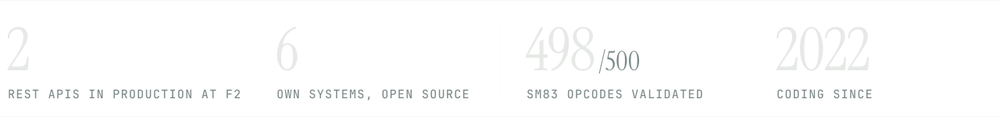
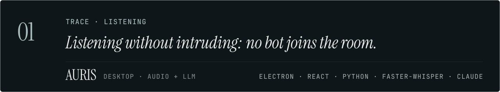
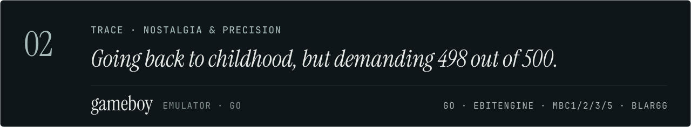
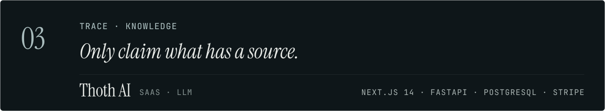
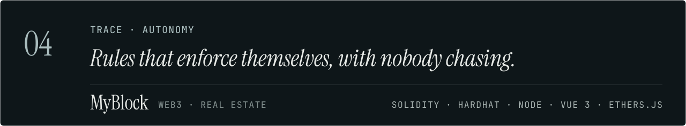
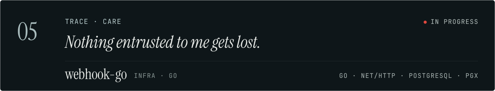
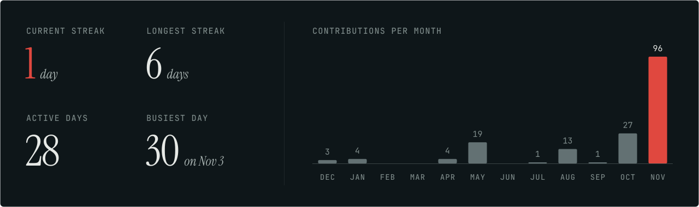

<a href="https://allisonfreittass.github.io/">
  <picture>
    <source media="(prefers-color-scheme: light)" srcset="assets/banner-neblina.svg">
    
  </picture>
</a>

I'm a full-stack engineer at **F2 Tecnologia**, mostly on the backend: public APIs, webhooks into third-party ERPs, and automations with LLMs. On my own time I build systems that keep running when nobody is watching, from a Game Boy emulator in Go to an agent with persistent memory.

B.Sc. in Computer Science · native Portuguese, fluent English · **open to relocation, Netherlands / EU first.**

<picture>
  <source media="(prefers-color-scheme: light)" srcset="assets/sobre-neblina.svg">
  
</picture>

  

<picture>
  <source media="(prefers-color-scheme: light)" srcset="assets/numeros-neblina.svg">
  
</picture>

  

<picture>
  <source media="(prefers-color-scheme: light)" srcset="assets/titulo-visao-neblina.svg">
  
</picture>

<a href="https://github.com/Allisonfreittass/visao">
  <picture>
    <source media="(prefers-color-scheme: light)" srcset="assets/visao-neblina.svg">
    
  </picture>
</a>

A persistent cognitive architecture around a swappable LLM: curated autobiographical memory, uncertainty-driven search, reflection and goals that survive across conversations. The agent is born without a name and deliberates about its own. *It does not claim consciousness, feelings or life.*

`Curated, opt-in memory` `Curiosity with cited sources` `Goals only run with approval` `Versioned, reversible adaptation` `Self-hosted voice` `Budget and cost per call`

**[View repository ↗](https://github.com/Allisonfreittass/visao)**

 

<picture>
  <source media="(prefers-color-scheme: light)" srcset="assets/titulo-rastros-neblina.svg">
  
</picture>

Every system I build leaves a trace of who I am. *The trait first, then the tech.*

<a href="https://github.com/Allisonfreittass/AURIS">
  <picture>
    <source media="(prefers-color-scheme: light)" srcset="assets/rastro-auris-neblina.svg">
    
  </picture>
</a>

A sales-call copilot: summary, next steps and the follow-up already written. It transcribes on your own machine, and no bot joins the meeting.
**[See it live ↗](https://auris-landing.pages.dev/)** · **[Code ↗](https://github.com/Allisonfreittass/AURIS)**

<a href="https://github.com/Allisonfreittass/gameboy">
  <picture>
    <source media="(prefers-color-scheme: light)" srcset="assets/rastro-gameboy-neblina.svg">
    
  </picture>
</a>

A Game Boy (DMG) emulator in Go: full SM83 CPU, pixel-perfect PPU on dmg-acid2, 4-channel audio and battery saves.
**[Code ↗](https://github.com/Allisonfreittass/gameboy)**

<a href="https://github.com/Allisonfreittass/thothai-web">
  <picture>
    <source media="(prefers-color-scheme: light)" srcset="assets/rastro-thoth-neblina.svg">
    
  </picture>
</a>

Train and chat with models over your own documents. Source-grounded RAG, async fine-tuning and recurring billing through Stripe.
**[Code ↗](https://github.com/Allisonfreittass/thothai-web)**

<a href="https://github.com/Allisonfreittass/myblock-backend">
  <picture>
    <source media="(prefers-color-scheme: light)" srcset="assets/rastro-myblock-neblina.svg">
    
  </picture>
</a>

Rentals where the contract is the system: Solidity keeps the status, applies a 10% late fee and closes the lease on its own.
**[Contracts ↗](https://github.com/Allisonfreittass/myblock-backend)** · **[Interface ↗](https://github.com/Allisonfreittass/myblock-frontend)**

<a href="https://github.com/Allisonfreittass/webhook-go">
  <picture>
    <source media="(prefers-color-scheme: light)" srcset="assets/rastro-webhook-neblina.svg">
    
  </picture>
</a>

A self-hosted webhook gateway. It accepts events from any source and writes the event and its pending delivery in the same transaction before answering 202, so nothing gets lost. Next up: the redelivery worker with scheduled retries.
**[Code ↗](https://github.com/Allisonfreittass/webhook-go)**

 

<picture>
  <source media="(prefers-color-scheme: light)" srcset="assets/titulo-ritmo-neblina.svg">
  
</picture>

<picture>
  <source media="(prefers-color-scheme: light)" srcset="assets/atividade-neblina.svg">
  
</picture>

<picture>
  <source media="(prefers-color-scheme: light)" srcset="assets/ritmo-neblina.svg">
  
</picture>

 

<picture>
  <source media="(prefers-color-scheme: light)" srcset="assets/titulo-percurso-neblina.svg">
  
</picture>

**F2 Tecnologia · Full-Stack Engineer** — *Mar 2025 to now*
Two REST APIs in production, with webhooks connecting the platform to ERPs. Deploys on Cloudflare Workers and Pages. Automations with n8n and LLMs. Working in English with code review on GitHub.

**B.Sc. Computer Science · UNIS-MG** — *2022 to 2025*
Completed at Centro Universitário do Sul de Minas.

`TypeScript` `Python` `Go` `Solidity` `SQL` `Node` `FastAPI` `React` `Next.js` `Vue` `Electron` `PostgreSQL` `MongoDB` `Docker` `Cloudflare` `n8n` `Anthropic` `OpenAI`

 

<picture>
  <source media="(prefers-color-scheme: light)" srcset="assets/contato-neblina.svg">
  
</picture>

  <a href="https://www.linkedin.com/in/allisonfreittass/"><b>LinkedIn ↗</b></a> &nbsp;·&nbsp;
  <a href="https://allisonfreittass.github.io/"><b>Portfolio ↗</b></a> &nbsp;·&nbsp;
  <a href="mailto:allisonfreittass@gmail.com"><b>allisonfreittass@gmail.com</b></a>

