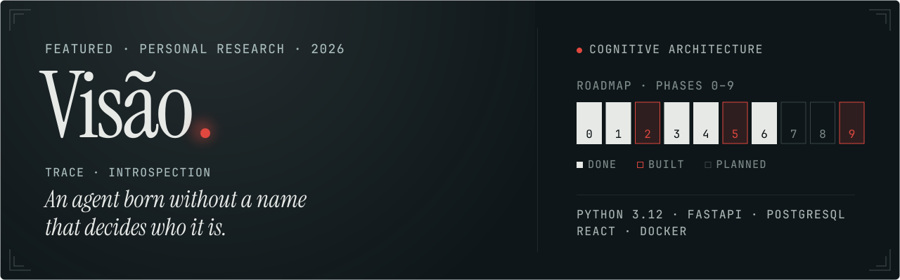
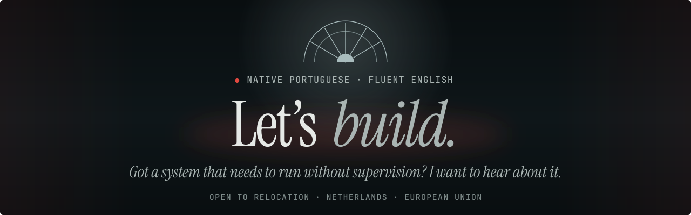

<a href="https://allisonfreittass.github.io/">
  <picture>
    <source media="(prefers-color-scheme: light)" srcset="assets/banner-neblina.svg">
    
  </picture>
</a>

Full-stack engineer at **F2 Tecnologia**, mostly backend. B.Sc. in Computer Science · native Portuguese, fluent English · **open to relocation, Netherlands / EU first.**

<picture>
  <source media="(prefers-color-scheme: light)" srcset="assets/sobre-neblina.svg">
  
</picture>

<a href="https://github.com/Allisonfreittass/visao">
  <picture>
    <source media="(prefers-color-scheme: light)" srcset="assets/visao-neblina.svg">
    
  </picture>
</a>

<picture>
  <source media="(prefers-color-scheme: light)" srcset="assets/rastros-neblina.svg">
  
</picture>

  <a href="https://github.com/Allisonfreittass/visao">Visão</a> ·
  <a href="https://github.com/Allisonfreittass/AURIS">AURIS</a> ·
  <a href="https://github.com/Allisonfreittass/gameboy">gameboy</a> ·
  <a href="https://github.com/Allisonfreittass/thothai-web">Thoth AI</a> ·
  <a href="https://github.com/Allisonfreittass/myblock-backend">MyBlock</a> ·
  <a href="https://github.com/Allisonfreittass/webhook-go">webhook-go</a>

<picture>
  <source media="(prefers-color-scheme: light)" srcset="assets/atividade-neblina.svg">
  
</picture>

<a href="https://www.linkedin.com/in/allisonfreittass/">
  <picture>
    <source media="(prefers-color-scheme: light)" srcset="assets/contato-neblina.svg">
    
  </picture>
</a>

  <a href="https://www.linkedin.com/in/allisonfreittass/"><b>LinkedIn</b></a> ·
  <a href="https://allisonfreittass.github.io/"><b>Portfolio</b></a> ·
  <a href="mailto:allisonfreittass@gmail.com"><b>allisonfreittass@gmail.com</b></a>

