<a href="https://allisonfreittass.github.io/">
  <picture>
    
  </picture>
</a>

### Software engineer · Full-stack at F2 Tecnologia

I build systems that keep running when nobody is watching: public APIs, webhooks into ERPs and automations with LLMs. Based in Varginha, Brazil, and open to relocating to the Netherlands / EU.

**Now** building [Visão](https://github.com/Allisonfreittass/visao), a cognitive architecture with persistent memory. 
**Beyond code** late nights, rain, The Neighbourhood.

#### Selected work

**[Visão](https://github.com/Allisonfreittass/visao)** · An agent born without a name that decides who it is. *Python, FastAPI, PostgreSQL* 
**[AURIS](https://github.com/Allisonfreittass/AURIS)** · A sales-call copilot that listens without a bot joining the room. *Electron, Python, faster-whisper* 
**[gameboy](https://github.com/Allisonfreittass/gameboy)** · A Game Boy emulator in Go, 498 of 500 SM83 opcodes validated. *Go, Ebitengine* 
**[Thoth AI](https://github.com/Allisonfreittass/thothai-web)** · Chat with your own documents, only claiming what has a source. *Next.js, FastAPI, RAG* 
**[MyBlock](https://github.com/Allisonfreittass/myblock-backend)** · Rental contracts that enforce themselves, with nobody chasing. *Solidity, Vue* 
**[webhook-go](https://github.com/Allisonfreittass/webhook-go)** · A webhook gateway where nothing entrusted to it gets lost. *Go, PostgreSQL*

#### Stack

TypeScript · Python · Go · SQL · Node · FastAPI · React · Next.js · PostgreSQL · Docker · Cloudflare · n8n

---

[Portfolio](https://allisonfreittass.github.io/) · [LinkedIn](https://www.linkedin.com/in/allisonfreittass/) · [allisonfreittass@gmail.com](mailto:allisonfreittass@gmail.com)
