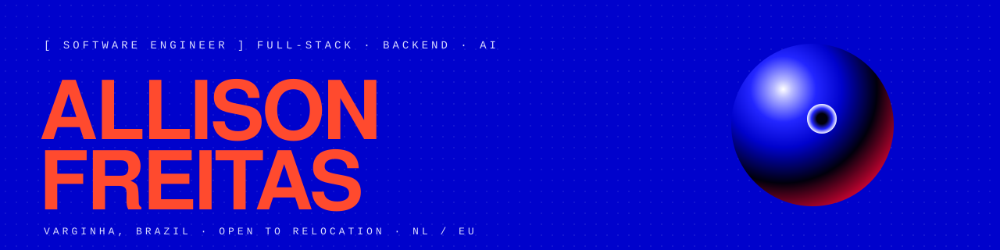

I'm a full-stack engineer at **F2 Tecnologia**, mostly on the backend: public APIs, webhooks into third-party ERPs, and automations with LLMs. On my own time I build systems that keep running when nobody is watching, from a Game Boy emulator in Go to an agent with persistent memory.

B.Sc. in Computer Science · native Portuguese, fluent English · **open to relocation, Netherlands / EU first.**

### Now

**[Visão](https://github.com/Allisonfreittass/visao)**: personal research on a persistent cognitive architecture around a swappable LLM. Curated autobiographical memory, uncertainty-driven curiosity with cited sources, goals that only run with approval, self-hosted voice. Phases 0–6 and 9 are built. It does not claim consciousness, feelings or life.
`Python 3.12` `FastAPI` `PostgreSQL` `React` `Docker`

### Selected work

| Project | What it does | Stack |
| --- | --- | --- |
| **[AURIS](https://github.com/Allisonfreittass/AURIS)** · [live](https://auris-landing.pages.dev/) | Sales-call copilot: summary, next steps and follow-up. Transcribes on your own machine; no bot joins the call. | Electron · React · Python · faster-whisper · Claude |
| **[gameboy](https://github.com/Allisonfreittass/gameboy)** | Game Boy (DMG) emulator. 498/500 SingleStepTests opcode files, pixel-perfect on dmg-acid2, MBC1/2/3/5, audio. | Go · Ebitengine |
| **[webhook-go](https://github.com/Allisonfreittass/webhook-go)** | Self-hosted webhook gateway. Stores the event and its pending delivery in one transaction before answering 202. Redelivery worker in progress. | Go · net/http · PostgreSQL · pgx |
| **[Thoth AI](https://github.com/Allisonfreittass/thothai-web)** | Train and chat with models over your own documents. RAG, async fine-tuning, Stripe billing. | Next.js · FastAPI · PostgreSQL |
| **[MyBlock](https://github.com/Allisonfreittass/myblock-backend)** | Rentals where the contract is the system: Solidity applies the late fee and closes the lease on its own. | Solidity · Hardhat · Node · Vue 3 |

### Stack

- **Languages**: TypeScript · Python · Go · Solidity · SQL
- **Backend**: Node.js · Express · FastAPI · REST · Webhooks
- **Frontend**: React · Next.js · Vue · Electron
- **Data**: PostgreSQL · MongoDB
- **AI & automation**: Anthropic · OpenAI · RAG · faster-whisper · n8n
- **Ship**: Docker · Cloudflare Workers & Pages · GitHub Actions

### Contact

[Portfolio](https://allisonfreittass.github.io/) · [LinkedIn](https://www.linkedin.com/in/allisonfreittass/) · allisonfreittass@gmail.com
